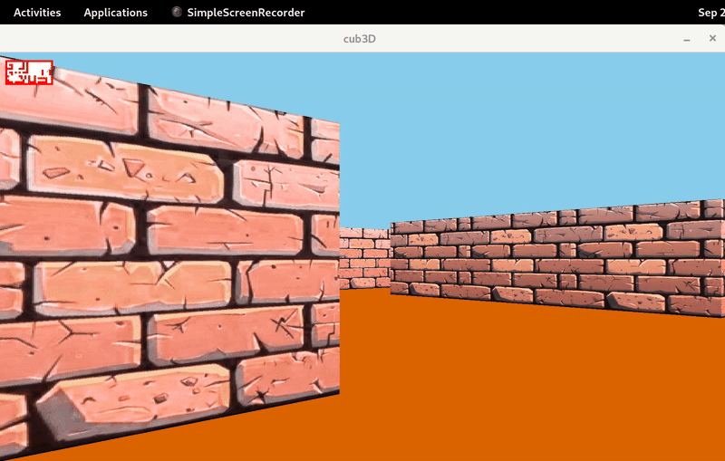

# cub3D

**A 3D first-person maze engine in C, built with raycasting like Wolfenstein 3D.**

**English** · [Català](README.ca.md) · [Español](README.es.md)

`Part of the 42 Barcelona Common Core` · `Rank 4` · `C` · `MiniLibX` · `Raycasting`

<p align="center"></p>

---

## Description

`cub3D` reads a map description file (`.cub`) and shows the maze in first person, with a different texture on each wall direction and custom floor and ceiling colours. It also draws a 2D minimap with the player position.

## What it teaches

- **Raycasting**: turning a 2D grid into a 3D image by casting one ray per screen column.
- The **DDA algorithm** to find which wall each ray hits, quickly and without gaps.
- Trigonometry and vectors for the player direction, rotation and field of view.
- Texture mapping: choosing the right pixel of the texture for each point of the wall.
- Parsing a configuration file with strict rules, and validating the map with flood fill.

## How it works

For every column of the window, a ray leaves the player in the viewing direction. The DDA algorithm moves the ray from cell to cell until it hits a wall. The distance to that wall decides how tall the column is drawn: near walls are tall, far walls are short. The side the ray hit (north, south, east or west) chooses the texture, and the exact hit point chooses the column of the texture. Using the perpendicular distance avoids the "fisheye" effect.

| Key | Action |
|:--:|:--|
| `W` `S` | move forward and backward |
| `A` `D` | move left and right |
| `←` `→` | turn the camera |
| `ESC` | quit |

Example `.cub` file:

```
NO ./textures/wall_north.xpm
SO ./textures/wall_south.xpm
WE ./textures/wall_west.xpm
EA ./textures/wall_east.xpm
F 220,100,0
C 225,30,0

111111
100001
10E001
111111
```

`NO`, `SO`, `WE`, `EA` are the wall textures, `F` and `C` the floor and ceiling colours in RGB, `1` is a wall, `0` is floor, and `N`, `S`, `E` or `W` is the player start position and direction.

## Build and run

```bash
git clone https://github.com/acarranz-dev/cube3D.git
cd cube3D

sudo apt install libx11-dev libxext-dev libbsd-dev   # MiniLibX dependencies
make
./cub3D maps/map.cub
```

## Project structure

```
cube3D/
├── src/
│   ├── parser/     # reads the .cub file: textures, colours, map and flood fill validation
│   ├── init/       # window, images and player start direction
│   ├── render/     # raycasting and textured wall columns
│   ├── minimap/    # 2D minimap and player movement
│   └── utils/
├── maps/           # example .cub maps
├── textures/
├── libraries/      # libft and MiniLibX
└── Makefile
```

---

[More projects on my profile](https://github.com/acarranz-dev)
